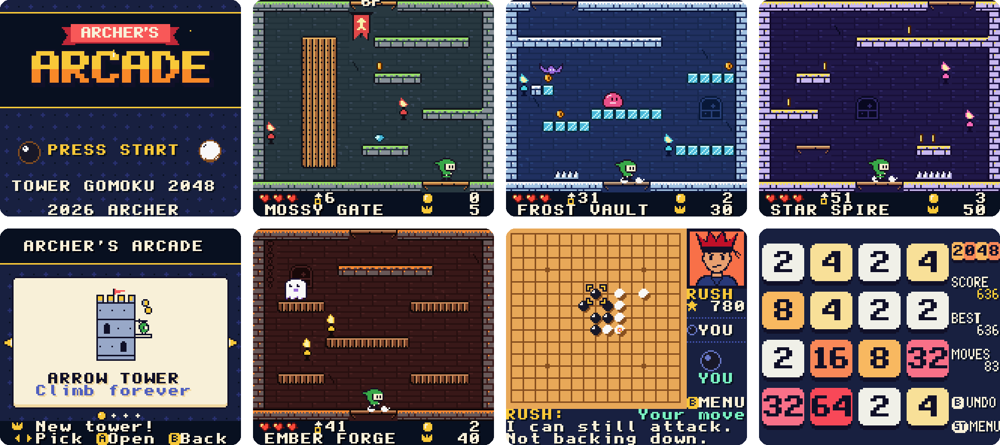

<p align="center">
  
</p>

# Archer's Arcade

A Game Boy Color cartridge with three games on it:

- **Arrow Tower**, an endless climb where the arrows you shoot become the ledges you stand on
- **Gomoku**, five in a row against ten rivals who each play (and talk) their own way
- **2048**

I made it for my ModRetro Chromatic. It also runs on a Game Boy Color, a Game Boy Advance, an Analogue Pocket or any good emulator.

**[Download the ROM](https://github.com/boyuchengz/archers-arcade/releases/latest)** · [Controls](#controls) · [Building](#building)

## Playing

Download `ArchersArcade-v3.1.gbc` from the [latest release](https://github.com/boyuchengz/archers-arcade/releases/latest). Open it in an emulator (SameBoy, mGBA, Gambatte, BGB and so on), or write it to a flash cartridge that supports MBC5 with a battery save. Records, Elo and unlocks are kept in the save.

It's a Color-only ROM, so it won't start on the original grey Game Boy or a Game Boy Pocket.

## The games

### Arrow Tower

Each floor is one room. Find the gap in the ceiling, jump through, and the camera pans up to the next floor. B fires an arrow. Arrows stick in wooden walls and hold your weight, so a lot of the game is putting a foothold in the right place. You get two at a time.

The floors don't run out. A room is either one of 39 hand-made layouts, mirrored and redecorated at random, or a new one built while you're still climbing the floor below. Every ten floors the tower changes zone: Mossy Gate, Old Library, Clockworks, Frost Vault, Ember Forge and Star Spire, each with its own colours and its own trouble (ice and falling icicles in the Frost Vault, cannons in the Forge, ghosts in the Spire). After floor 60 the zones come round again with faster enemies.

On the way up there are spikes, crumbling blocks, springs, moving platforms, saws, slimes, bats and ghosts. Stomp or shoot the soft ones. A campfire every ten floors refills your three hearts and becomes a floor you can start from next time. Every 50 coins in a run buys back a heart, and the coins you bank unlock eight hood colours for the hero, the last one at 2,000.

### Gomoku

Five in a row on a 15×15 board. Ranked pairs you with rivals near your Elo and moves you up from Rookie through Bronze, Silver, Gold, Platinum and Diamond to Master. Practice lets you pick any of the ten rivals, and 2 Players is pass-and-play.

Every rival has a portrait with four expressions, a voice for their lines and a way of playing. PIP is quick, careless and very beatable. SOREN reads forcing sequences several moves deep and rarely leaves you an opening.

### 2048

The sliding-tile puzzle, with chunky keycap tiles from 2 up to 16384, undo, and a best score that survives switching off.

## Controls

|        | Arrow Tower              | Gomoku               | 2048                  |
| ------ | ------------------------ | -------------------- | --------------------- |
| D-pad  | Run                      | Move the cursor      | Slide the tiles       |
| A      | Jump (hold to go higher) | Place a stone        |                       |
| B      | Shoot                    | Game menu            | Undo                  |
| Start  | Pause                    | Game menu            | Pause                 |
| Select |                          | Hide the result card | Back to the main menu |

In the menus, Left and Right pick, A opens and B goes back. On the Arrow Tower start screen, Left and Right choose the starting floor and Up and Down choose a hood.

## Building

The games are written in C as a custom scene type for [GB Studio](https://www.gbstudio.dev) 4.3.2, which supplies the boot code, the engine and the GBDK toolchain. Open `project.gbsproj` in GB Studio and export a ROM, or build from the command line:

```sh
node /path/to/gb-studio/out/cli/gb-studio-cli.js make:rom project.gbsproj ArchersArcade.gbc
```

Art, music, dialogue and the tower rooms are generated into C headers by the Python scripts in `tools/` (they need Pillow). Run the one you need after changing it:

```sh
python3 tools/make_art.py        # font, UI, logo, menu illustrations, 2048 tiles, board
python3 tools/make_portraits.py  # the ten rivals
python3 tools/make_music.py      # soundtrack and jingles
python3 tools/make_openings.py   # the rivals' opening book
python3 tools/make_dialogue.py   # the rivals' lines
python3 tools/make_tower.py      # Arrow Tower tiles, sprites, palettes and rooms
```

The art scripts also write preview sheets to `tools/preview`.

### Tests

Most of the game logic also compiles on a desktop, so it's tested there. This runs the 2048, Gomoku, AI and rival/save suites:

```sh
sh tests/run.sh
```

For Arrow Tower, the first command checks the 39 hand-made rooms, and the other two build 10,000 floors with the real room code and check that each one can be climbed:

```sh
python3 tools/tower_rooms.py
cc -O2 -w -Iplugins/tabletop/engine/include -Iplugins/tabletop/engine/src/states tests/test_tower_gen.c -o /tmp/towergen
/tmp/towergen 10000 42 | python3 tools/check_tower_rooms.py
```

`tests/difficulty_sim.c` plays simulated players against every rival to check the difficulty ladder. [VALIDATION.md](VALIDATION.md) has the notes from the last full round of testing.

## How it's put together

The code is in `plugins/tabletop/engine/src/states` (the project's working name was Archer's Tabletop):

| Files | What's in them |
| --- | --- |
| `tabletop.c`, `tt_menu.c` | Start-up, title screen, menus |
| `tt_tower*.c` | Arrow Tower: physics, actors, room builder, drawing, hoods |
| `tt_gomoku.c`, `tt_gocore.c`, `tt_ai.c`, `tt_pattern*.c` | Gomoku table, rules, AI and its pattern tables |
| `tt_rivals.c`, `tt_portraits.c` | Rivals, matchmaking, portraits |
| `tt_puzzle.c`, `tt_puzzle_view.c` | 2048 |
| `tt_gfx.c`, `tt_fx.c`, `tt_irq.c`, `tt_audio.c`, `tt_save.c` | Graphics, particles, scrolling, sound, saves |

A few things that took some care:

- **Endless rooms that are always climbable.** `tools/tower_rooms.py` simulates the hero's jump and checks every hand-made room from every entrance it accepts. The builder in `tt_tower_gen.c` works from the bottom up, puts each ledge within reach of the one below and reserves every jump arc and landing spot, so the hazards and enemies added afterwards can't block the way.
- **No hitch between floors.** The background is a 32-row ring. The next room is built in the rows above while you play, a small step each frame, and zone colours fade across during the camera pan.
- **Memory.** The project's copies of GB Studio's `vm.h`, `actor.h`, `projectiles.h`, `trigger.h` and `ui.h` shrink engine buffers this cartridge never uses, and Arrow Tower borrows the Gomoku AI's work area while it runs, so it adds almost no permanent RAM.
- **A real difficulty ladder.** Each rival has a skill profile in `tt_ai.c`: how often they miss their own five, overlook your four or make a careless attacking move, and how deep they read.
- **Old saves keep working.** New records are appended to the end of the save, so saves from earlier versions load unchanged.

## Versions

- **3.1**: coins buy back hearts; banked coins unlock hood colours.
- **3.0**: Arrow Tower, and the cartridge became Archer's Arcade.
- **2.1**: each Gomoku rival plays at its own strength.
- **2.0**: new font, animated title screen, card menus, redrawn rivals, ranked matchmaking and an original soundtrack.
- **1.0**: Gomoku and 2048, as Archer's Tabletop.

## License

[MIT](LICENSE). The five engine headers above are modified from GB Studio, which is also MIT licensed; its notice is included in the LICENSE file.

Made by [Boyucheng Zhang](https://boyucheng.me).
