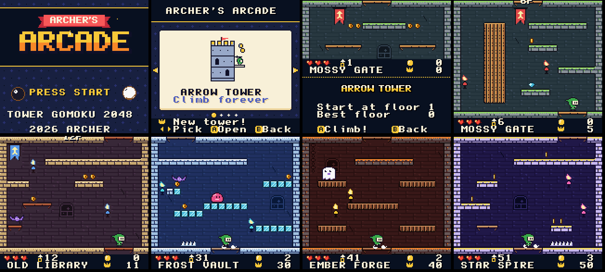

# Archer's Arcade (v3)

A Game Boy Color cartridge with three games, built for the ModRetro Chromatic: ARROW TOWER, Gomoku and 2048. Author: Archer.

## What's new in v3: ARROW TOWER

An endless tower climb. Each floor is one room; jump up through the planks in the ceiling and the camera pans to the floor above.

- **Arrows**: B shoots. Arrows stick in wood walls and become footholds (two at a time), pop slimes, bats and ghosts, and grab coins on the way.
- **Endless floors**: every room is either one of 39 hand-made layouts (mirrored at random, with hazards, enemies and coins that change with difficulty) or a brand-new layout built on the spot. Past floor 20 about half the rooms are new layouts.
- **Six zones** that change every 10 floors, each with its own colours and hazards: Mossy Gate, Old Library, Clockworks, Frost Vault (slippery ice, falling icicles), Ember Forge (cannons) and Star Spire (ghosts). After floor 60 the zones repeat with faster enemies.
- **Hazards and enemies**: spikes, crumbling blocks, springs, moving platforms, saws on rails, cannons, falling icicles, slimes, bats and ghosts. Stomp or shoot the soft ones.
- **Campfire checkpoints** every 10 floors refill your hearts and unlock a new starting floor (choose it with Left/Right on the start screen).
- **Coins and gems** (gem = 5 coins, popping an enemy = 1): every 50 coins in a run gives back a heart, or +10 coins if you're at full health. When a run ends its coins go into your coin bank, which unlocks hood colours for the hero: Forest, Ruby (50), Ocean (150), Sunny (300), Violet (500), Shadow (800), Frost (1200) and the rainbow Prism (2000). Pick a hood with Up/Down on the start screen.
- Three hearts, coins, best-floor record, a new soundtrack ("Up the Spire") with zone and campfire jingles, and a sound for every action.
- The cartridge is now called Archer's Arcade, with a new title logo and a four-card main menu.

Tower controls: D-pad left/right runs, A jumps (hold for higher), B shoots, Start pauses (Resume, Restart run, Main menu).

### How the endless rooms stay fair

- `tools/tower_rooms.py` holds the templates and a checker that simulates the hero's jump reach. Every template must be climbable from each entrance it accepts, and every exit lane must have rooms that can follow it.
- `tt_tower_gen.c` builds new rooms bottom-up. Each ledge is placed within jumping reach of the one below, and every jump arc and standing spot is protected so later decoration, hazards and enemies can't block it.
- `tests/test_tower_gen.c` compiles the real room builder on the desktop and prints thousands of rooms; `tools/check_tower_rooms.py` runs the checker on every one:

      cc -O2 -w -Iplugins/tabletop/engine/include -Iplugins/tabletop/engine/src/states tests/test_tower_gen.c -o /tmp/towergen && /tmp/towergen 10000 42 | python3 tools/check_tower_rooms.py

### Under the hood

- The tower scrolls a 32-row background ring; the next room is built in the rows above while you climb, spread over frames (one build step per frame, much of it during the camera pan) so play doesn't stutter.
- Art for the tower is generated by `tools/make_tower.py` (tiles, sprites, six zone palettes, panel titles, room data). Zone colours cross-fade during the pan into a new zone.
- The tower borrows the Gomoku line-code table as its work area, so it adds very little permanent RAM. The unused GB Studio script heap was shrunk to leave a safe margin for the C stack.
- Old saves load unchanged; the tower record is appended to the save.

## v2 "Game Night"

## What's new in v2

- **Readable type everywhere**: a new bold 2-pixel-stem font with drop shadows and lowercase, no cryptic abbreviations.
- **Animated title screen** with a ribbon logo, drifting star pattern, bobbing stones and sparkles.
- **Swipeable card menus** (smooth hardware-scrolled carousel) with illustrations for every mode.
- **Ten redrawn rivals** with personalities and four expressions each (neutral, happy, shocked, sad). They react to your play, type their lines out letter by letter with their own voice pitch.
- **Ranked matchmaking roulette**, rank titles (Rookie to Master), and an Elo change readout after each game.
- **Gomoku table**: wooden board, glossy stones that drop in with a clack, pulsing cursor, last-move marker, and a sparkle chain plus confetti over the winning five.
- **2048**: colorful keycap tiles (2 through 16384), rolling score counter, "+points" popups, merge sparkles, screen shake on big merges, new-best and 2048 celebrations, pause menu.
- **Original soundtrack**: title theme, a 2048 groove, a calm pentatonic Gomoku theme, plus win, lose, 2048 and new-best jingles. Sound effects for every action.
- Smooth fades between every screen.

Saves from v1 load unchanged (same save layout). Music now defaults to on; turn it off in Settings.

## v2.1: a real difficulty ladder

In earlier builds all ten rivals played at the same strength. Now each rival has its own skill profile in `tt_ai.c` (`skills` table): how often it misses its own five, overlooks your four or makes a careless attacking move, how deep it reads four-chains (VCF), whether it sees yours, and how far it looks ahead. PIP is genuinely beatable; SOREN plays exactly as strong as before. Practice always gives you black (the first move).

`tests/difficulty_sim.c` plays simulated players against every rival to check the ladder:

    cc -O2 -w -Iplugins/tabletop/engine/include -Iplugins/tabletop/engine/src/states tests/difficulty_sim.c -o /tmp/sim && /tmp/sim 400

## Controls

Menus: Left/Right pick, A open, B back.

ARROW TOWER: Left/Right run, A jump, B shoot, Start pause. On the start screen Left/Right picks a checkpoint floor and Up/Down picks a hood.

Gomoku: D-pad moves the cursor, A places a stone, B or Start opens the game menu (Resume, Undo in Practice, Resign). After a game, A plays again, B returns to the menu, Select hides the result card so you can look at the board.

2048: D-pad slides, B undoes the last move, Start pauses (Resume, New game, Main menu), Select returns to the main menu.

## Build and edit

Open `project.gbsproj` in GB Studio 4.3.2, or build headlessly:

    node <gb-studio>/out/cli/gb-studio-cli.js make:rom project.gbsproj ArchersArcade.gbc

All gameplay and presentation is C in `plugins/tabletop/engine` (the TABLETOP scene type). Art, music and dialogue are generated into headers by Python scripts in `tools` (they need Pillow):

    python3 tools/make_art.py        # font, UI kit, sprites, logo, illustrations, 2048 cards, board
    python3 tools/make_portraits.py  # rivals (writes tools/preview/portraits.png for review)
    python3 tools/make_music.py      # soundtrack and jingles
    python3 tools/make_openings.py   # rival opening book
    python3 tools/make_dialogue.py   # rival dialogue
    python3 tools/make_tower.py      # ARROW TOWER tiles, sprites, palettes and rooms (also writes tools/preview/tower_*.png)

`tools/preview` holds rendered previews of the generated art. Run `sh tests/run.sh` (needs a C compiler) for the desktop rules, AI, rival and save checks.

The project-local `vm.h`, `actor.h`, `projectiles.h`, `trigger.h` and `ui.h` derive from GB Studio 4.3.2 (MIT, see LICENSE). They shrink engine buffers this dedicated scene never uses (including the script heap, since the project defines no script variables), which frees RAM for the games.
